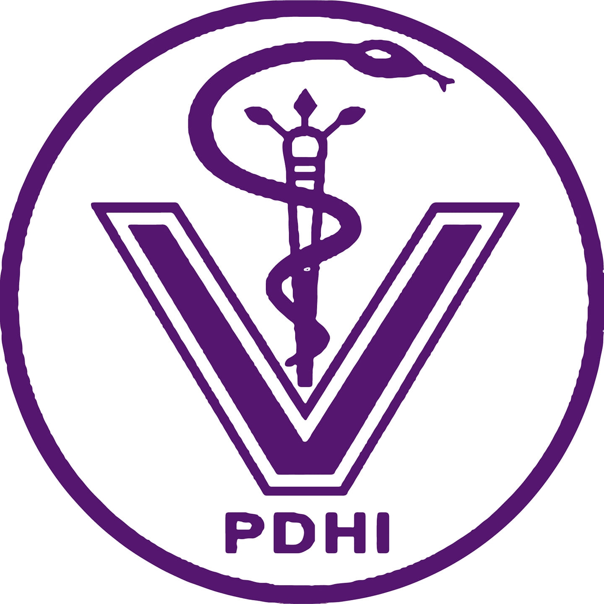
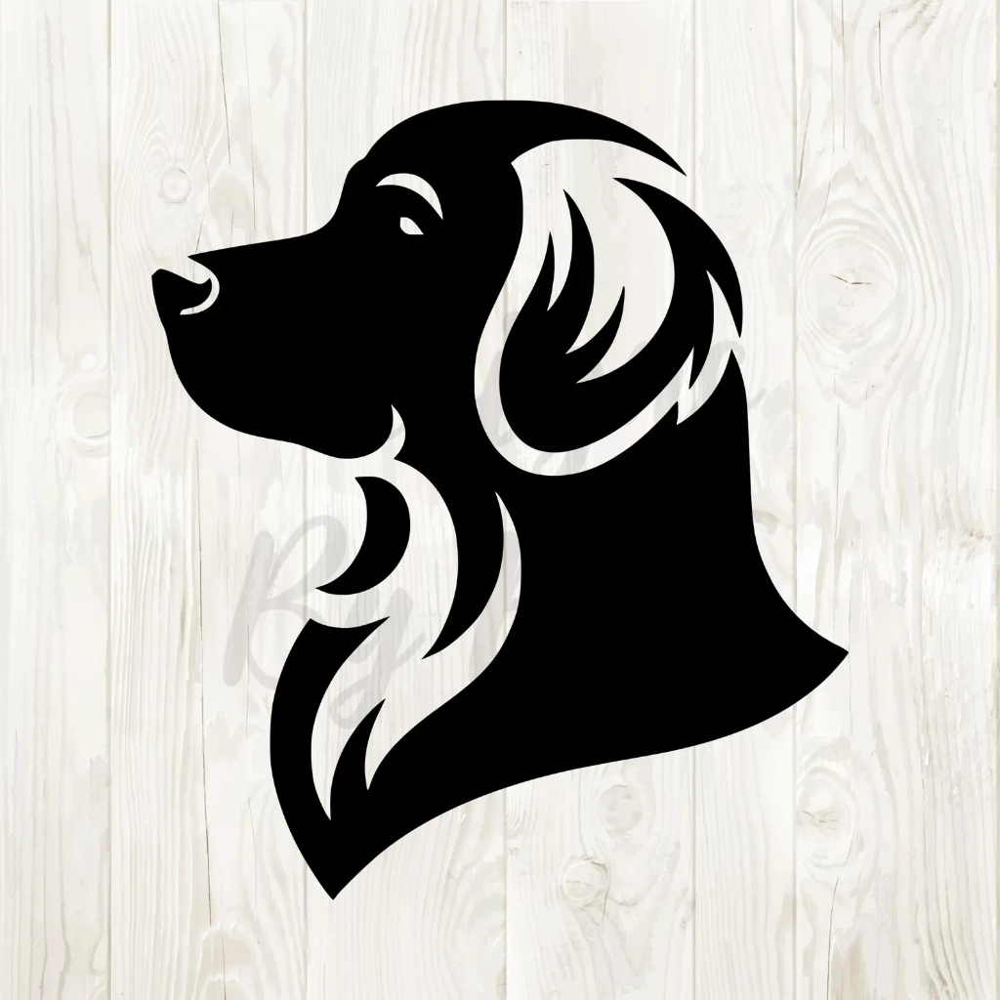
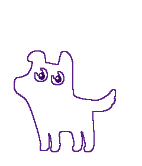

<p align="center">
  
</p>

<h1 align="center">Sistem Administrasi Anggota PDHI Cabang Banten II</h1>

<p align="center">
  Platform administrasi keanggotaan terintegrasi untuk <strong>Perhimpunan Dokter Hewan Indonesia (PDHI) Cabang Banten II</strong>.
</p>

<p align="center">
  
  
  
  
  
</p>

---

## 📌 Tentang Aplikasi

Aplikasi ini dirancang untuk memodernisasi dan mengotomatiskan pengelolaan keanggotaan dokter hewan di lingkungan **PDHI Cabang Banten II**, mulai dari pendaftaran anggota baru, verifikasi berkas digital, pelacakan masa aktif keanggotaan, hingga penyusunan laporan resmi (PDF dan Excel).

Dilengkapi dengan desain antarmuka modern bernuansa warna khas PDHI (*Imperial Violet*), interaksi pengguna responsif, dan maskot interaktif yang ramah.

---

## 📸 Pratinjau Tampilan (Screenshots)

### Halaman Login Interaktif
Halaman login modern dengan maskot interaktif *puppy* dan *cat arm* yang responsif mengikuti gerakan kursor pengguna, efek jejak kaki (*paw trail*), serta fitur lihat/sembunyikan password.

<p align="center">
  
</p>

<p align="center">
  
  &nbsp;&nbsp;&nbsp;&nbsp;&nbsp;&nbsp;
  
</p>

---

## ✨ Fitur-Fitur Utama

### 👨‍💼 Panel Administrator
- **Dashboard & Statistik Real-Time**: Ringkasan data anggota aktif, pendaftaran baru, permohonan perpanjangan, serta berkas yang perlu diverifikasi.
- **Manajemen Akun Pengguna**: Penambahan akun, edit profil, pengelolaan role (Admin/Dokter), aktivasi/penonaktifan, dan reset password mandiri oleh admin.
- **Data Master Dokter Hewan**: Informasi lengkap profil dokter, nomor kontak, klinik/tempat praktik, asal perguruan tinggi (alumni), dan riwayat status keanggotaan.
- **Verifikasi & Approval Berkas**: Validasi berkas persyaratan pendaftaran anggota baru dengan pratinjau dokumen digital.
- **Manajemen Keanggotaan & Perpanjangan**: Pembaruan status masa aktif anggota serta perpanjangan keanggotaan berkala.
- **Pusat Laporan & Ekspor Data**:
  - Ekspor data anggota ke format **Excel (.xlsx)**.
  - Cetak laporan resmi berformat **PDF** siap cetak.

### 🩺 Panel Dokter Hewan (Anggota)
- **Formulir Registrasi Mandiri**: Input data dokter hewan (biodata, nomor kontak, riwayat pendidikan alumni, informasi klinik atau tempat praktik).
- **Pengelolaan Berkas Digital**: Unggah dan kelola berkas persyaratan keanggotaan (Ijazah, Sertifikat Kompetensi, SKPB, Surat Rekomendasi/Izin Praktik, KTP, dan Pas Foto).
- **Syarat & Ketentuan Keanggotaan**: Panduan lengkap persyaratan pendaftaran cabang.
- **Keamanan Akun**: Fitur ubah kata sandi akun secara mandiri dan aman.

### 🎨 Peningkatan UI/UX
- **Palet Warna Harmonis PDHI**: Warna utama *Noble Royal Violet* (`#581c87`), *Lilac Tint*, dan indikator status semantik yang nyaman di mata.
- **Tabel Responsif Modern**: Striping kontras tinggi, penataan kolom rapi, *action cluster buttons*, dan *sticky columns* pada tampilan desktop.
- **Komponen Datepicker Halus**: Integrasi Bootstrap Datepicker dengan auto-dismiss saat memilih tanggal.
- **Desain Adaptif**: Tampilan tetap rapi dan mudah diakses melalui desktop, tablet, maupun ponsel pintar.

---

## 🛠️ Tumpukan Teknologi

- **Backend**: [Laravel 8](https://laravel.com/)
- **Bahasa Pemrograman**: PHP 8.x
- **Basis Data**: MySQL / MariaDB
- **Frontend**: Blade Templating, Bootstrap 4, jQuery, Stisla UI, FontAwesome 5
- **Export & Document Generator**: `maatwebsite/excel`, `barryvdh/laravel-dompdf`

---

## 🚀 Panduan Instalasi Lokal

### 1. Prasyarat Sistem
- PHP >= 8.0
- Composer
- MySQL >= 5.7 atau MariaDB >= 10.3
- Web Server (Apache / Nginx / Laragon / XAMPP)

### 2. Kloning Repositori
```bash
git clone https://github.com/vikyardnsyh/pdhi.git
cd pdhi
```

### 3. Instal Dependensi
```bash
composer install
```

### 4. Konfigurasi Lingkungan (`.env`)
Salin file template lingkungan dan sesuaikan kredensial basis data:
```bash
cp .env.example .env
```
Buka file `.env` dan atur konfigurasi database:
```env
DB_CONNECTION=mysql
DB_HOST=127.0.0.1
DB_PORT=3306
DB_DATABASE=pdhi_banten
DB_USERNAME=root
DB_PASSWORD=
```

### 5. Generate Application Key & Jalankan Migrasi
```bash
php artisan key:generate
php artisan migrate --seed
```

### 6. Jalankan Server Pengembangan
```bash
php artisan serve
```
Akses aplikasi melalui browser di: `http://localhost:8000`

---

## 📄 Lisensi

Hak Cipta &copy; Perhimpunan Dokter Hewan Indonesia (PDHI) Cabang Banten II. Dikembangkan untuk keperluan administrasi dan layanan keanggotaan.
